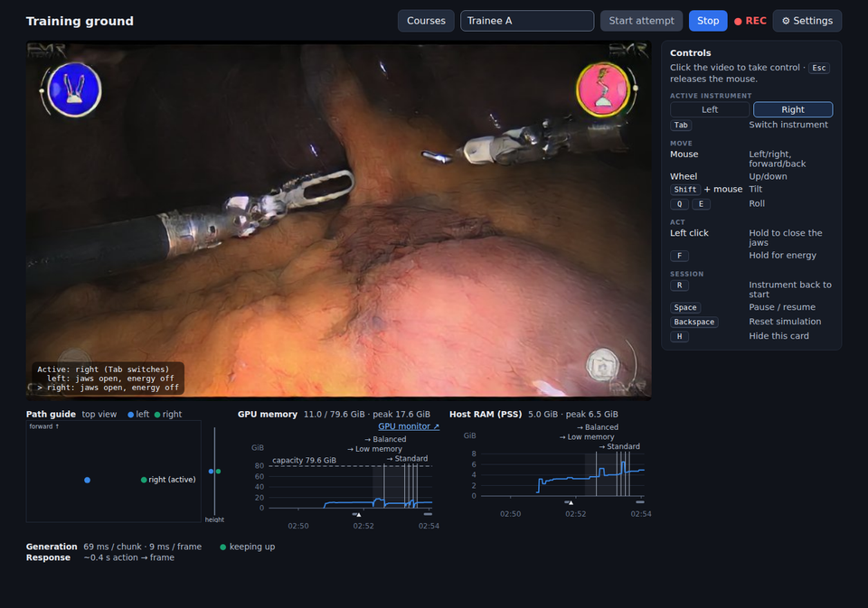
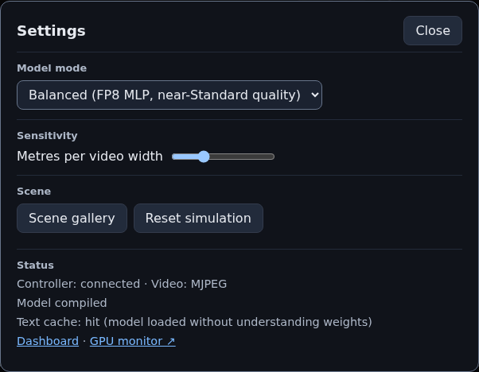
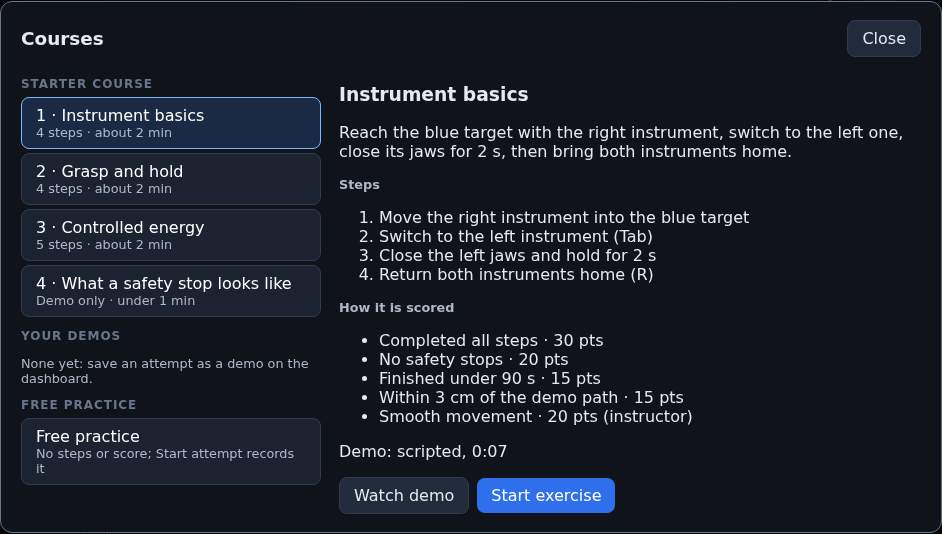

<!--
SPDX-FileCopyrightText: Copyright (c) 2026 NVIDIA CORPORATION & AFFILIATES. All rights reserved.
SPDX-License-Identifier: Apache-2.0
-->

# Training ground: setup and user guide

This guide takes you from an empty Linux machine to trainees using the
Cosmos3-H-Dreams training ground. It assumes you are comfortable with a Linux
shell, but not that you know this repository.

Times and sizes were measured on an NVIDIA H100 80 GB server unless a line says
otherwise. A laptop RTX 5090 (24 GB) is the target device; expect it to be
slower, especially the first start.

## 1. What you get

A web page at `https://<server>:8443/train`. A trainee drives two simulated
surgical instruments with the mouse and keyboard (or a Meta Quest headset), and
a world model generates the endoscope video live from those movements. Around
it: guided exercises with scoring (**Courses**), safety stops on unsafe motion
or energy use, a recording of every attempt, an instructor **dashboard** to
review and grade them, and a GPU memory monitor.



## 2. Requirements

| Item | Requirement |
|---|---|
| Operating system | Linux x86_64. Tested on Ubuntu 24.04. On Windows, use WSL 2: see [windows-laptop-setup.md](windows-laptop-setup.md). macOS is not supported |
| GPU | One NVIDIA GPU. VRAM depends on the model mode (below). Tested on H100; the laptop RTX 5090 (24 GB) is the target |
| NVIDIA driver | **580 or newer** (CUDA 13). The Python environment brings its own CUDA libraries; only the driver comes from the system |
| Host RAM | 32 GB minimum. The first start peaks at about 28 GB once (text-cache build); normal runs use about 14 GB |
| Disk | About 45 GB free (see the table below) |
| Software | `git`, `curl`, `ffmpeg`, `openssl`, a C compiler (`gcc`, used by Triton), and [uv](https://docs.astral.sh/uv/) 0.11.8 or newer. uv installs Python 3.12 itself |
| Network | Internet access to Hugging Face for the model download and the first start. Trainee PCs and headsets must reach the server on TCP port 8443 |
| Browser | A current Chrome, Edge or Firefox on the trainee PC; the Meta Quest Browser on a headset |

**VRAM per model mode** (process memory reported by `nvidia-smi`, steady state,
H100, from [the test kit](rtx5090-test-kit.md#7-reference-numbers-h100)):

| Mode | VRAM | Notes |
|---|---:|---|
| Standard | 15.8 GB | Best quality (bf16) |
| Balanced | 10.6 GB | FP8 for the MLP layers; near-Standard quality. Default of the laptop config |
| Low memory | 9.2 GB | FP8 everywhere; slightly lower fidelity |

All three generate a chunk in about the same time on H100 (70–85 ms). Leave
headroom for the desktop and other programs if the GPU also drives a display.

**Disk** (measured on this repository's branch):

| Item | Size |
|---|---:|
| Model checkpoint | 30.3 GB |
| Python environment (`.venv`) | 4.7 GB |
| uv download cache (`~/.cache/uv`, can be cleaned after install; from the test kit) | about 5 GB |
| Files downloaded on first start (Hugging Face cache) | 2.7 GB |
| Compiler caches (Triton, TorchInductor) | about 70 MB |
| Text cache | 6 MB |
| Recordings | about 15 MB per minute of attempt |

**Check the driver:**

```bash
nvidia-smi --query-gpu=name,driver_version,memory.total --format=csv
```

The driver version must be 580 or higher. The `CUDA Version` in the header of
plain `nvidia-smi` must be 13.0 or higher.

**Install the system packages** (Ubuntu):

```bash
sudo apt-get update
sudo apt-get install -y git curl ffmpeg openssl build-essential
curl -LsSf https://astral.sh/uv/install.sh | sh
source $HOME/.local/bin/env
uv --version          # 0.11.8 or newer
```

## 3. Install

```bash
cd ~
git clone https://github.com/ITRI-BDL-D/CosmosSurgeryRobot
cd CosmosSurgeryRobot
uv sync --package flashdreams-cosmos3-h-dreams --locked
```

`uv sync` downloads about 5 GB of Python packages (PyTorch, CUDA libraries)
and creates a 4.7 GB `.venv` in the repository. How long it takes depends on
your connection; once the packages are in the uv cache, it takes seconds.

**Optional, RTX 50 GPUs only: faster attention.** SageAttention2 makes each
chunk 13–15 % faster on an RTX 5090 or 5080 (it is slower on an H100, where the
server ignores it). It is built from source, which needs `git`, a C++ compiler
and the CUDA 13 toolkit (`nvcc`), and takes 10–30 minutes:

```bash
scripts/install_sageattention.sh
```

The server then uses it automatically and prints
`attention: sage (sm_120, self-test passed)` at start-up. If the build is
missing or fails its self-test, the server prints why and uses the standard
kernel. `uv sync` removes it again; re-run the script afterwards.

**Every command in the rest of this guide runs from the repository root**
(`~/CosmosSurgeryRobot`). Paths in the configuration files are relative to the
directory you launch from.

## 4. Download the model

The checkpoint is public on Hugging Face
([nvidia/Cosmos3-H-Dreams](https://huggingface.co/nvidia/Cosmos3-H-Dreams));
no account or token is needed. It is 30.3 GB.

```bash
uv run --no-sync python -c "
from huggingface_hub import hf_hub_download
print(hf_hub_download('nvidia/Cosmos3-H-Dreams',
      'checkpoints/exp15/c3-h-d_2-step_model_bf16.safetensors', local_dir='data_local/hf'))"
mkdir -p data_local/checkpoints
mv data_local/hf/checkpoints/exp15/c3-h-d_2-step_model_bf16.safetensors data_local/checkpoints/
sha256sum data_local/checkpoints/c3-h-d_2-step_model_bf16.safetensors
# expect 3e6fce0046a6fe46c65307245df0db041c4a1828e0b3fc76708fb30e7851c97b
```

The checksum takes about 20 s. Use the **2-step** checkpoint shown here; the
training-ground configs are tuned for it.

The bundled configs expect the file at
`data_local/checkpoints/c3-h-d_2-step_model_bf16.safetensors`. If you keep it
elsewhere (for example on a bigger disk), either symlink it there:

```bash
mkdir -p data_local/checkpoints
ln -s /data/models/c3-h-d_2-step_model_bf16.safetensors data_local/checkpoints/
```

or change `runtime.checkpoint` in your config file (section 6) to the full
path, or add `--checkpoint /full/path.safetensors` to the launch command.

## 5. HTTPS certificate

Browsers only allow mouse capture and VR (WebXR) on pages served over HTTPS
when the page comes from another machine, so the server always uses HTTPS. A
self-signed certificate is enough on a private network.

Create `cert.pem` and `key.pem` in the repository root. The certificate lists
the machine's hostname and IP address; trainees must open the page with one of
these names:

```bash
HOST=$(hostname)
IP=$(hostname -I | awk '{print $1}')
openssl req -x509 -newkey rsa:2048 -nodes -keyout key.pem -out cert.pem -days 365 \
  -subj "/CN=$HOST" -addext "subjectAltName=DNS:$HOST,DNS:localhost,IP:$IP,IP:127.0.0.1"
openssl x509 -in cert.pem -noout -ext subjectAltName    # check the names
```

`hostname -I` prints the first address of the machine; if trainees reach it
through another address, put that address in `IP=` instead. Regenerate the
certificate when the address changes, and after 365 days. Keep `key.pem`
private. The bundled configs read `cert.pem` and `key.pem` from the launch
directory (`headset.cert` and `headset.key`).

**Accept the certificate in the browser.** The first time each browser opens
the page it shows a warning (for example "Your connection is not private").
In Chrome or Edge choose **Advanced → Proceed to … (unsafe)**; in Firefox
**Advanced → Accept the Risk and Continue**. On a Meta Quest, the Meta Quest
Browser shows the same kind of warning: open **Advanced** and proceed. To
avoid the warning, use a certificate from your organisation's own certificate
authority instead, at the same paths.

## 6. Choose a config

Two training-ground configs ship in `cosmos3_h_dreams/configs/`:

| Config | Use it on | Starts in |
|---|---|---|
| `laptop_rtx5090.yaml` | GPUs with 24 GB or less, such as the laptop RTX 5090 | Balanced |
| `training_ground.yaml` | GPUs with 32 GB or more, such as an H100 | Standard |

Everything else in the two files is the same. Trainees or instructors can
switch the mode at any time in **/train → ⚙ Settings → Model mode**; the
config only chooses the mode the server starts in.

To change settings, copy a config and edit the copy, so that updates do not
overwrite your changes:

```bash
cp cosmos3_h_dreams/configs/laptop_rtx5090.yaml data_local/my_site.yaml
```

What you may want to edit:

| Key | What it does |
|---|---|
| `runtime.checkpoint` | Path of the model checkpoint |
| `runtime.fp8_generation`, `runtime.fp8_scope` | Start-up mode: `false` = Standard; `true` + `fp8_scope: mlp` = Balanced; `true` alone = Low memory |
| `runtime.attention_kernel` | `auto` (default) uses SageAttention on RTX 50 GPUs when installed (section 3); `default` never does |
| `headset.cert`, `headset.key` | Certificate files |
| `scenes` | The starting images. `initial_frame` takes a path or a wildcard such as `data_local/scenes/*.png`; each image becomes a scene in the **Scene gallery**. All scenes must use the same prompt |
| `safety` | Limits for the safety stops (section 8). The shipped values are about the highest surgeons reached in 40 recorded gallbladder surgeries |
| `recording.dir` | Where attempts are saved (default `recordings/`) |
| `courses.dir`, `courses.demos_dir` | Exercise files and saved demos. Delete the `courses:` block to hide the **Courses** button |

Every relative path in the file is resolved from the directory you launch
from (the repository root), not from the file's own folder.

## 7. First start

The compiler cache goes to `/tmp` by default, which Ubuntu empties at every
reboot, so the next start would compile again. Keep it in your home folder
instead (add the line to `~/.bashrc` to make it permanent):

```bash
export TORCHINDUCTOR_CACHE_DIR=$HOME/.cache/torchinductor
```

Then start the server:

```bash
uv run --no-sync cosmos3-h-dreams-run headset \
  --session-config cosmos3_h_dreams/configs/laptop_rtx5090.yaml
```

For use on the server itself, `scripts/start_training_ground.sh` does the
same with `--http` and the compiler cache in your home folder; open
`http://localhost:8443/train`.

Use `training_ground.yaml` (or your own copy) in place of
`laptop_rtx5090.yaml` as chosen above. Useful options:

| Option | Default | Meaning |
|---|---|---|
| `--port N` | 8443 | TCP port |
| `--host ADDR` | `0.0.0.0` (all interfaces) | Use `127.0.0.1` to allow only this machine |
| `--checkpoint PATH` | from the config | Overrides `runtime.checkpoint` |
| `--http` | off (HTTPS) | Plain HTTP without a certificate, for a trusted closed network: open `http://<server-IP>:<port>/train`. Anyone who can reach the port can use the server, so keep it on the internal network. `/headset` needs HTTPS (WebXR) |

To let a colleague test from their own PC on the same network, start the server
on a port your network allows and give them the server's address:

```bash
uv run --no-sync cosmos3-h-dreams-run headset \
  --session-config cosmos3_h_dreams/configs/laptop_rtx5090.yaml --http --port 9001
hostname -I    # the server's address, e.g. http://10.1.2.3:9001/train
```

Only one browser tab controls the instruments at a time; a second `/train` tab
keeps showing "Reconnecting…" until the first one closes. `/viewer` shows the
video to anyone.

The web server answers within a few seconds; the model loads in the
background. On the **first** start it also:

1. downloads the image decoder, the VAE and the tokenizer from Hugging Face
   (2.7 GB; about 40 s on our network);
2. hashes the checkpoint (about 30 s) and builds the **text cache**
   (`data_local/text_kv/…`, 6 MB) once. This is the step that needs about
   28 GB of host RAM. Later starts skip it and load the model without its
   language-understanding weights;
3. compiles the model for the GPU. With empty compiler caches this took
   2.3 minutes on the H100; on a laptop GPU it can take several minutes.

| Start | Ready after (H100) |
|---|---:|
| First start, nothing cached | 3.6 min (217 s) |
| Later starts (text cache and compiler caches present) | 36–40 s |
| Switching the model mode in Settings, first time into a mode | 20–40 s; 1–2 min the very first time on a machine (compile) |
| Switching back to a mode used before in the same run | about 8 s |

The **/train** page shows the progress over the video: "Loading model…",
"Compiling model…", then the video appears. The same text is in the server's
log. The server is ready when `/healthz` reports `"ready": true`:

```bash
curl -sk https://localhost:8443/healthz | python3 -m json.tool | head -5
```

**Do the first start before trainees arrive**, and once more after every
update, so that nobody waits for the build and compile. In
**⚙ Settings → Status** the line "Text cache: hit (model loaded without
understanding weights)" confirms that later starts take the fast path.

Stop the server with **Ctrl+C**. A Python traceback printed while it shuts
down (for example from `shutdown_compile_workers`) is harmless.

## 8. Using the training ground

Open `https://<server>:8443/train` on the trainee PC, where `<server>` is the
hostname or IP address in the certificate. Accept the certificate warning
the first time.

| Page | For |
|---|---|
| `/train` | The trainee's page |
| `/dashboard` | Instructors: list, replay and grade attempts |
| `/gpu` | Live GPU memory and host RAM charts |
| `/headset` | A Meta Quest headset (instead of `/train`) |
| `/viewer` | A second screen that watches without controlling |
| `/healthz` | Machine-readable status (JSON) |

There is **no login**. Anyone who can reach the port can drive the
simulation, change the mode and watch every recording, including trainee
names. Use it on a trusted network only and never expose the port to the
internet.

### Controls

Click the video to take control of the mouse; **Esc** releases it. Hold still
for a moment after starting: the start pose is captured as the reference.

The two instruments have different tools. In the shipped configs the **left
instrument is a grasper** (jaws only) and the **right instrument is a hook**
(energy only); the right one is active when the page opens. The Controls card
labels them ("Left · Grasper", "Right · Hook") and dims a control the active
instrument lacks. Pressing it does nothing, and the overlay on the video says
which instrument has that tool.

| Input | Action |
|---|---|
| Mouse move | Move the active instrument left/right and forward/back |
| Scroll wheel | Move up/down |
| Shift + mouse | Tilt |
| Q / E | Roll the wrist |
| Hold left mouse button | Close the jaws (grasper) |
| G | Lock the grasper's jaws closed, so they stay closed while you Tab to the hook; G again (or a left click on the grasper) releases them |
| Hold F | Energy (hook) |
| Tab | Switch between the left grasper and the right hook |
| R | Return the active instrument to its start pose |
| Space | Pause / resume |
| Backspace | Reset the simulation |
| H | Hide or show the Controls card |
| Esc | Release the mouse |

### Attempts

Type the trainee's name, click **Start attempt**, and click the video. A red
**● REC** shows while recording. **Stop** ends the attempt. A reset, a scene
change or a mode change ends the attempt and starts a new one for the same
trainee. Each attempt is saved as a folder under `recordings/` with the video
(`video.mp4`), the movements and a timeline of events.

### Settings

**⚙ Settings** holds:

- **Model mode**: Standard, Balanced or Low memory. Switching ends the current
  attempt and reloads the model (see the times in section 7). If a mode does
  not fit in GPU memory, the page shows the error and the previous mode
  comes back.
- **Input rate**: how often your movement becomes a video frame, 5–60 Hz
  (default 30). Above 30 Hz the page also moves and sends at that rate; this
  needs a fast GPU (an H100 keeps up at 60 Hz: 62 ms per chunk against a
  133 ms budget). Use the arrows, or type a number and press Enter;
  the time one chunk of 8 frames may take at that rate shows beside it. If the
  latency readout says **falling behind**, lower the rate: the GPU then has
  more time per chunk and keeps up, and motion is slightly less smooth. The
  page suggests a rate when it falls behind. The change applies at once,
  without reloading the model, and cannot be made during an attempt (a
  recording has one rate). It resets to the config's `headset_input_fps` when
  the server restarts.
- **Sensitivity**: how far the instrument moves for a full video width of
  mouse travel (default 10 cm), how far one mouse-wheel notch moves it up or
  down (default 3 mm), and how fast Q/E roll it (default 0.5 rad/s).
- **Scene gallery** (when the config has more than one scene) and
  **Reset simulation**.
- **Status**: the connection, the model state and the text-cache line, with
  links to the dashboard and the GPU monitor.



### Courses

**Courses** opens the exercise menu. The starter course has four exercises:
Instrument basics, Grasp and hold, Controlled energy, and a demo-only
exercise that shows what a safety stop looks like.



- Each exercise has numbered **steps** (for example "Move the right hook
  into the blue target") that tick off in order, and a **rubric** that says
  how it is scored.
- **Watch demo** plays a reference demonstration on the live model. Space
  pauses it, 0.5×/1× sets the speed, and **Try it yourself** starts the
  exercise. Demos are not recorded.
- **Start exercise** resets the simulation and starts a recorded attempt. The
  right column shows the step checklist and a safety meter; the **path guide**
  under the video shows the instruments from above, the target zone and the
  demo path, with a height bar on its right (the yellow box is the target
  height). For a reach step, the line under the step on the video gives the
  distance to the target and the height to fix ("3.0 cm too high · scroll
  down"); for a lift or move step it shows the distance so far ("2.1 cm / 5.0
  cm").
- When the last step is done (or after **Stop exercise**) a **report card**
  shows the automatic score, the rubric and the time per step. Items marked
  "instructor" are scored later on the dashboard, so the score shows as
  "70 + ?" until then. The scoring is illustrative, not a clinical standard.
- **Smoothness** on the report card counts **corrections**: each time an
  instrument speeds up and slows down again is one movement. A smooth reach is
  one; hesitant stop-and-go motion is many. The score is the demo's count
  divided by yours (100 at the demo's count or fewer), and the Corrections tile
  shows both numbers.

Exercises always run on one scene (`courses.scene` in the config, by default
the first scene): starting an exercise or a demo switches to it, and the scene
gallery is locked while an exercise attempt runs. Free practice can use any
scene.

The bundled configs offer 26 starting frames in the Scene gallery: the
original example and 25 more from other CMR cholecystectomies
(`assets/scenes/cholecystectomy/`, CC BY 4.0; see its README for the sources).
Every one has the grasper on the left and the energy hook on the right. In
"Cholecystectomy 15 · Gallbladder lifted" the grasper already holds the
gallbladder, so the page starts its jaws locked closed, as if you had pressed
G ("jaws locked closed (G or click releases)"); the **Drag the gallbladder**
exercise runs on that scene.

More starting frames can come from the public
[Open-H-Embodiment](https://huggingface.co/datasets/nvidia/PhysicalAI-Robotics-Open-H-Embodiment)
dataset (CC BY 4.0; credit it where you show the frames), whose
`Surgical/cmr_surgical/cholecystectomy/videos` clips are the same robot and
procedure the model learned. Pick a moment with the grasper on the left and the
hook on the right, save that frame as a PNG and add it as a scene:

```bash
ffmpeg -ss 10 -i episode_000400.mp4 -frames:v 1 data_local/scenes/chole_calot.png
```

```yaml
scenes:
  - initial_frame: assets/example_data/scenes/*.png
  - {name: chole-calot, label: "Cholecystectomy · Calot's triangle", initial_frame: data_local/scenes/chole_calot.png}
```

Exercises are YAML files in `cosmos3_h_dreams/courses/`; the format is
described in [the package README](../cosmos3_h_dreams/README.md#training-courses).
The server checks every exercise file at start-up and refuses to start with a
message naming the file and field if one is invalid, including a step or demo
that uses a tool the instrument lacks (for example closing the hook's jaws).

The tools come from the session config's `instruments` block:

```yaml
instruments:
  left: {name: Grasper, tools: [jaws]}
  right: {name: Hook, tools: [energy]}
```

`tools` lists `jaws`, `energy`, both or neither. Without the block both
instruments have both tools. The server also drops a control an instrument
lacks before it reaches the model, so the headset follows the same rule.

### Latency readout

Under the video, `/train` shows how fast the model runs:

```text
Generation  69 ms / chunk · 9 ms / frame        ● keeping up
Response    ~0.4 s action → frame
```

The model makes video in chunks of 8 frames, and the page sends movements at
30 per second, so a chunk must be ready within 267 ms.

| Status | Meaning | What to do |
|---|---|---|
| ● keeping up (green) | Generation takes less than 80 % of the budget | Nothing |
| ● near the limit (amber) | 80–100 % of the budget | Consider Balanced or Low memory; close other GPU programs |
| ● falling behind (red) | Generation is slower than real time: the video pauses briefly after each chunk and some movements are skipped (the delay does not grow) | Lower **⚙ Settings → Input rate** (the page suggests a rate); switch to Low memory; check that the laptop is on mains power and in a performance power profile |
| ● falling behind (playback) | The display rate is too low for the input rate | Use the training-ground configs, which play at 30 fps |

**Response** is the delay from a mouse movement to the first frame that shows
it. About 0.36–0.4 s is normal on the H100; most of it is waiting for a
chunk's 8 movements to arrive.

### Safety stops

Before each chunk, the server checks the movements against the limits in the
config's `safety:` block: instrument speed, acceleration, rotation rate,
continuous energy time, energy time within a window, and distance moved while
energy is on. If a movement breaks a limit, that chunk is not generated, the
video holds, and the page names the limit, for example
`Right instrument: speed 0.98 m/s, limit 0.35 m/s`. Click **Resume** to
continue from the last safe pose. Every stop is recorded as an incident.

The shipped limits sit at about the highest values surgeons reached in the
hand motion of 40 CMR cholecystectomies (Open-H-Embodiment): speed 0.35 m/s,
acceleration 3 m/s², rotation 4 rad/s, energy 10 s at a time and 14 s in any
15 s, and 10 cm moved while energized. Tune them for your scenario; to suggest
values from recorded raw `[N, 28]` trajectories:

```bash
uv run --no-sync python -m cosmos3_h_dreams.safety calibrate trajectory.npy \
  --fps 10 --translation-scale 10
```

Safety stops apply only to `/train`, not to `/headset`.

### Dashboard (instructors)

`https://<server>:8443/dashboard` lists all attempts with date, trainee,
exercise, scene, mode, duration, safety stops, score, energy time and peak
VRAM. Filter by trainee and exercise; with both chosen, a chart shows the
score per attempt. Open an attempt to replay its video with a timeline:
incidents are red markers, energy orange spans, pause/resume/reset grey ticks;
clicking a marker jumps to 3 s before it. For an exercise attempt you can tick
the instructor rubric items, write notes, **Save review**, and **Save as
demo** to turn a good attempt into a demo for the Courses menu. To delete an
attempt, delete its folder under `recordings/`.

### GPU monitor

`https://<server>:8443/gpu` shows GPU memory (used, PyTorch reserved and
allocated) and host RAM over the last 5, 10 or 30 minutes, with mode switches
and attempts marked. Every sample is also written to
`recordings/gpu-<date>-<time>.csv`, one file per server run.

### Meta Quest headset

Instead of the mouse, a trainee can use a Meta Quest with its two
controllers:

1. On the headset, open the Meta Quest Browser and go to
   `https://<server>:8443/headset`. Accept the certificate warning.
2. Close `/train` on every PC first: the server accepts **one** controlling
   page at a time. A second one shows "Connection lost · Reconnecting…" until
   the first closes.
3. Select **Enter VR**. Track both controllers, release both triggers and hold
   still; the starting pose is captured after 0.3 s.
4. Controller movement drives the instruments; the index trigger closes the
   grasper's jaws; the grip button applies the hook's energy (with the shipped
   `instruments` block, the other controller's trigger or grip does nothing). Hold both controllers' primary buttons
   for one second to restart and recalibrate.

Open `https://<server>:8443/viewer` on a PC to let others watch. The headset
page has no courses, recordings or safety stops; those are `/train` features.

## 9. Day-to-day

**Start and stop.** Start with the command in section 7 from the repository
root; stop with Ctrl+C. Wait for `"ready": true` before trainees start.

**Run in the background** with `nohup`:

```bash
cd ~/CosmosSurgeryRobot
export TORCHINDUCTOR_CACHE_DIR=$HOME/.cache/torchinductor
nohup uv run --no-sync cosmos3-h-dreams-run headset \
  --session-config cosmos3_h_dreams/configs/laptop_rtx5090.yaml > server.log 2>&1 &
tail -f server.log                                # Ctrl+C stops following, not the server
pkill -INT -f "cosmos3-h-dreams-run headset"      # stop the server
```

Or as a **systemd user service** that starts at boot:

```bash
mkdir -p ~/.config/systemd/user
cat > ~/.config/systemd/user/training-ground.service <<EOF
[Unit]
Description=Cosmos3-H-Dreams training ground

[Service]
WorkingDirectory=$HOME/CosmosSurgeryRobot
Environment=TORCHINDUCTOR_CACHE_DIR=$HOME/.cache/torchinductor
ExecStart=$(command -v uv) run --no-sync cosmos3-h-dreams-run headset --session-config cosmos3_h_dreams/configs/laptop_rtx5090.yaml
KillSignal=SIGINT
Restart=on-failure

[Install]
WantedBy=default.target
EOF
systemctl --user daemon-reload
systemctl --user enable --now training-ground
sudo loginctl enable-linger $USER                 # keep it running when you are logged out
journalctl --user -u training-ground -f           # the log
```

**Where data lives:**

| What | Where |
|---|---|
| Attempts (video, movements, events, reviews) | `recordings/<date>-<time>_<trainee>/` |
| GPU log | `recordings/gpu-<date>-<time>.csv` |
| Demos saved from the dashboard | `data_local/demos/` |
| Text cache | `data_local/text_kv/c3-h-d_2-step_480x832.pt` |
| Checkpoint | `data_local/checkpoints/` |
| Downloaded decoder, VAE and tokenizer | `~/.cache/huggingface/` (or `$HF_HOME`) |
| Compiler caches | `$TORCHINDUCTOR_CACHE_DIR` (see section 7; otherwise `/tmp/torchinductor_<user>`) and `~/.triton/cache` |

Back up `recordings/` and `data_local/demos/`. Everything else can be
recreated. Paths under `recordings/` and `data_local/` are relative to the
repository root, and git ignores them.

**Update:**

```bash
cd ~/CosmosSurgeryRobot
git pull
uv sync --package flashdreams-cosmos3-h-dreams --locked
```

Then do a start before trainees arrive (section 7). The text cache is rebuilt
only when the checkpoint's contents, the prompt, the resolution or the
tokenizer change. A copied or touched checkpoint with the same contents costs
one re-hash (about 17–30 s) and no rebuild. To force a rebuild, delete
`data_local/text_kv/`.

## 10. Troubleshooting

**The page says "Model startup failed — check server logs".** Read the end of
the server output. The usual causes:

- *Checkpoint not found*: the path in `runtime.checkpoint` is relative to the
  directory you launched from. Launch from the repository root, or use a full
  path (section 4).
- *`CUDA driver version is insufficient`* or no GPU found: the driver is older
  than 580. Update the NVIDIA driver; check with `nvidia-smi`.
- *`CUDA out of memory`*: start in a smaller mode (`laptop_rtx5090.yaml`
  starts in Balanced; for Low memory set `fp8_generation: true` and remove
  `fp8_scope`). Close other programs that use the GPU (`nvidia-smi` lists
  them).
- *Killed, or the machine freezes during the first start*: not enough host
  RAM for the text-cache build (about 28 GB). Close other programs or add swap
  for the one-time build; later starts need about 14 GB.
- *Download errors*: the first start needs Hugging Face. Check
  `curl -I https://huggingface.co`; behind a proxy, set `HTTPS_PROXY`.

**The page does not load from another machine.**

- Check that the server runs: `curl -sk https://localhost:8443/healthz` on
  the server itself.
- Open the firewall port, for example `sudo ufw allow 8443/tcp`.
- Use `https://`, not `http://`, and the port number.
- Do not launch with `--host 127.0.0.1`; the default `0.0.0.0` listens on
  every interface.
- If port 8443 is taken, choose another with `--port` and use it in the URL.

**Certificate warnings that do not go away, or the mouse cannot be
captured.** The address in the browser's address bar must be in the
certificate. Check with
`openssl x509 -in cert.pem -noout -ext subjectAltName` and regenerate it
(section 5) with the address trainees use.

**The first start is very slow.** It downloads files, builds the text cache
and compiles; see section 7. Watch the log for progress. If every start after
a reboot is slow (over 2 minutes in "Compiling model…"), the compiler cache
was in `/tmp` and was cleared: set `TORCHINDUCTOR_CACHE_DIR` as in section 7.

**"falling behind".** The GPU cannot generate in real time in this mode.
Switch to Balanced or Low memory, close other GPU programs, and on a laptop
use mains power and the performance power profile. `/gpu` shows whether the
GPU is busy with something else.

**Triton or compiler errors** (`gcc: not found`, `ptxas`, `cuda_utils`):
install `build-essential` (section 2) and start again.

**A mode switch fails.** The page shows the error and reloads the previous
mode. The new mode usually did not fit in GPU memory.

**"REC (no video)".** `ffmpeg` is missing or the disk is full; the attempt's
movements and events are still saved. Install `ffmpeg`.

**Testing a new GPU.** To check whether a GPU model runs in real time and how
much memory each mode needs, run the hardware test kit described in
[rtx5090-test-kit.md](rtx5090-test-kit.md).

For everything else, the [package README](../cosmos3_h_dreams/README.md)
documents every option and API.
